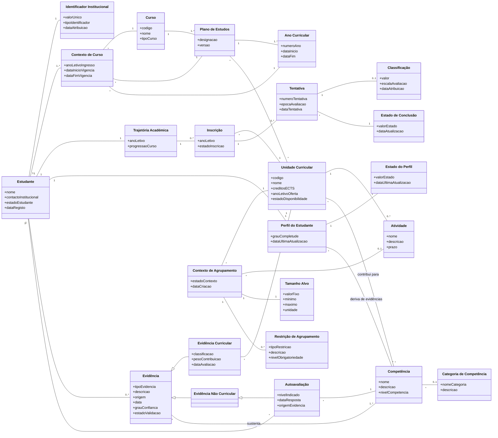

# Modelo de Domínio — Diagrama de Classes

Este documento apresenta o diagrama de classes do domínio do StudyMatch, construído a partir dos conceitos, atributos, relações e cardinalidades definidos na issue #16.

O diagrama representa exclusivamente conceitos do domínio. Não inclui controllers, services, repositories, DTOs, endpoints, tabelas de base de dados ou outros elementos de implementação. A tabela técnica `app_status` também não faz parte do modelo.

## Notas

- Os conceitos, atributos-chave, relações e cardinalidades seguem o modelo de domínio definido na issue #16.
- Os nomes apresentados no diagrama correspondem aos conceitos utilizados no modelo de domínio.
- As relações de especialização representam:
  - `Evidência Curricular` como especialização de `Evidência`;
  - `Evidência Não Curricular` como especialização de `Evidência`;
  - `Autoavaliação` como especialização de `Evidência Não Curricular`.
- O diagrama contém apenas elementos do domínio.
- A tabela técnica `app_status` não faz parte do modelo de domínio.
